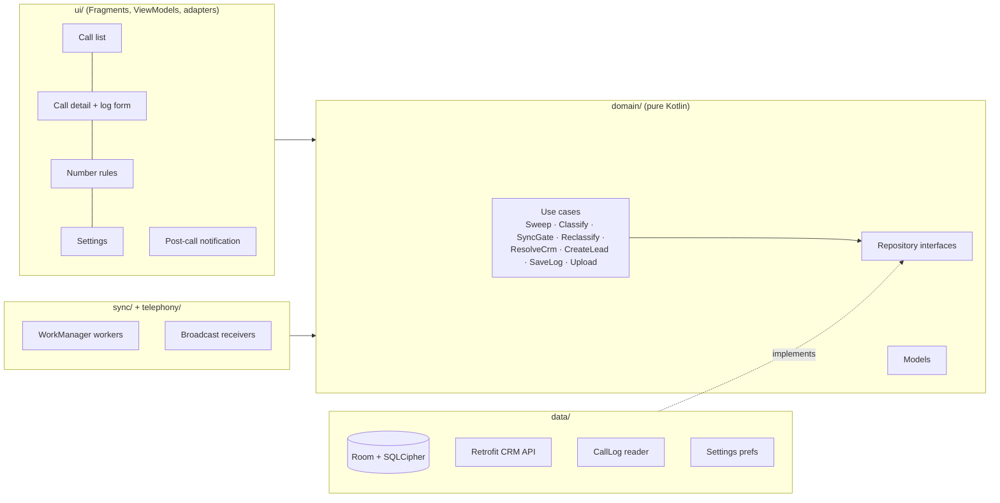
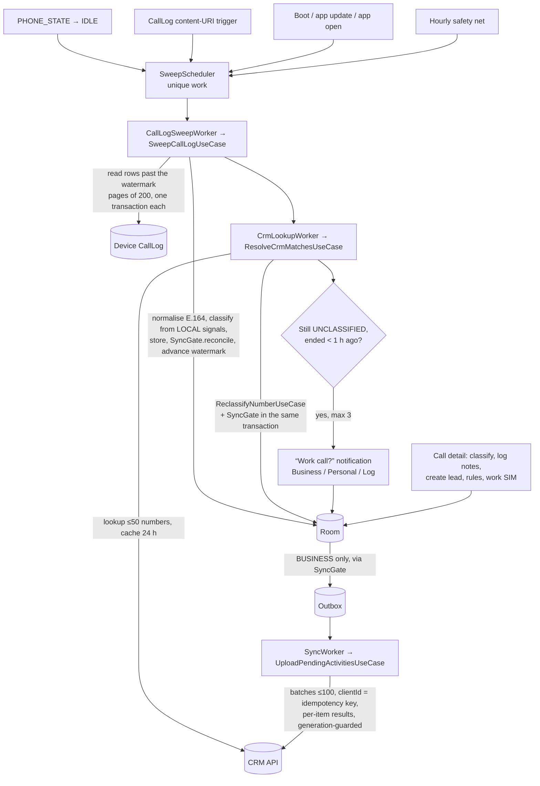

# Architecture

Single Android module, **MVVM + Clean Architecture**, Hilt for DI, Coroutines/Flow throughout. The database (Room,
encrypted with SQLCipher) is the **single source of truth**: screens only observe it, and everything that touches the
network writes its result back into it.

## Layers



| Package | Responsibility | Rule |
|---|---|---|
| `domain/` | Models, repository **interfaces**, use cases (all business rules) | No `android.*` imports → every rule is JVM-testable. Paging's core (`androidx.paging`) is pure Kotlin and allowed. |
| `data/` | Room DAOs/entities, SQLCipher key, CallLog reader, Retrofit API + DTOs, repository implementations | Implements domain interfaces; never decides policy. |
| `sync/` | `CoroutineWorker`s and their schedulers | Workers are thin: they call one use case and map the result to success/retry. |
| `telephony/` | `PHONE_STATE` and boot receivers | Triggers only — they read no call data. |
| `ui/` | Fragments (XML + ViewBinding), ViewModels (`StateFlow` state, `Channel` one-off events), notification | Observes Room; never shows network results directly. |
| `di/` | Hilt modules (DB, network, dispatchers, application scope) | |

## The pipeline: from a phone call to the CRM



1. **Detection.** Every trigger only *schedules* a sweep; the sweep reads the **CallLog**, which is the source of truth
   (it has the real type, duration and SIM; the `PHONE_STATE` broadcast doesn't). A watermark (`_ID` + date, plus a fixed
   7-day floor) makes sweeps incremental, idempotent and crash-safe.
2. **Classification first, from local signals only:** the number's saved answer (every user answer is saved as a number
   rule), else the work SIM, else Unsorted. The CRM doesn't decide.
3. **Prompt** only for numbers with no saved answer, only conversations, only recent, at most three showing at a time.
   The answer is saved for the number.
3b. **CRM, for professional calls only:** a lookup links the call to the Lead/Contact; not found → the lead is created
   from the phonebook name (setting, default on) or Create lead is offered. Personal/unsorted numbers are never sent.
4. **Outbox.** A BUSINESS call gets an activity (with a client UUID) and an outbox row; edits re-arm the row with a new
   `generation`.
5. **Upload.** Batches go to `POST /activities/batch`; each item's result is applied on its own, only if its generation
   is unchanged since it was sent.

## The privacy boundary

```mermaid
flowchart LR
    subgraph PHONE["Stays on the phone (encrypted)"]
        ALL[All calls, contact names,<br/>PERSONAL + UNCLASSIFIED calls]
    end
    SG{{SyncGate.reconcile<br/>the ONLY way into the outbox}}
    ALL --> SG
    SG -->|BUSINESS only| OUT[(Outbox)]
    OUT --> CHK{{Uploader re-checks BUSINESS<br/>builds ActivityPayload: contract fields only}}
    CHK --> NET[CRM]
    ALL -. E.164 number only, never for numbers<br/>marked personal .-> LOOK[CRM lookup]
```

- `SyncGate.reconcile()` is the single caller of `OutboxRepository.enqueue`; every change to a call's classification
  or log calls it **in the same transaction**, so classification and outbox can never disagree. A call that stops being
  BUSINESS is removed from the outbox (unless already uploaded).
- The uploader re-checks BUSINESS right before building the payload (defence in depth) and the payload type holds only
  the API contract's fields — no contact names.
- CRM lookups send only the E.164 number; numbers with a PERSONAL rule or a call marked personal by hand are never
  looked up.
- Logs: counts, HTTP codes and exception types only (`LogHygieneTest`); release builds strip info logging.

## Background work

All background work is **WorkManager** (`CoroutineWorker`), always **unique work**, no long-running services.

| Worker | Started by | Constraints / policy | Does |
|---|---|---|---|
| `CallLogSweepWorker` | PHONE_STATE idle (+3 s), boot, app update, app open, content trigger, hourly periodic | unique `APPEND_OR_REPLACE`; periodic `KEEP` | Imports new CallLog rows; schedules CRM lookup |
| `CallLogChangedWorker` | Content-URI trigger on `CallLog.Calls.CONTENT_URI` (re-armed after every sweep) | unique `REPLACE` | Requests a sweep (catches calls even when PHONE_STATE was suppressed) |
| `CrmLookupWorker` | After a sweep that imported calls (no network constraint, so prompts aren't delayed); retry work needs `CONNECTED` | `APPEND_OR_REPLACE` / retry `REPLACE` (a new call restarts the backoff), exponential backoff | Looks up numbers, reclassifies, posts/cancels prompts |
| `SyncWorker` | Every enqueue (5 s debounce), app start, hourly periodic; **Upload now** | `CONNECTED`, exponential backoff 30 s; `APPEND_OR_REPLACE` (Upload now: `REPLACE`) | Uploads the outbox |

## Storage

Room database `calltracker.db`, **encrypted with SQLCipher**; the 256-bit key is random, generated once, and stored
wrapped (AES-GCM) by a non-exportable Android Keystore key. If the Keystore key is lost, a new database is created and
calls are re-read from the CallLog. Backups and device transfer exclude it (`allowBackup=false`).

| Table | Holds |
|---|---|
| `calls` | One row per imported CallLog row (unique on CallLog id + start), normalised number, type, times, SIM, classification + its source, linked CRM record |
| `activities` | The CRM activity of a BUSINESS call: client UUID (idempotency key), log fields, `updated_at`, server id/version |
| `outbox` | One row per activity to upload: status, `generation`, attempts, last error |
| `number_rules` | "Always business/personal" per number |
| `crm_cache` | Last CRM answer per number (including "not in CRM") with its time |
| `sweep_state` | The CallLog watermark and the 7-day floor |

Settings (work SIM, dismissed hints) are in plain `SharedPreferences` — nothing sensitive, and readable before the
database is opened. Schema history: `app/schemas/`; migrations in `data/local/Migrations.kt`.

## Screens

Single activity (`MainActivity` implements `AppNavigator`) with plain fragment transactions; a handful of screens didn't
justify a navigation library. A side menu (on the list only) opens: Call activities (paged from Room, filters in SQL)
→ call detail (classify, CRM record, log form, create lead, upload status) · Sync queue (Pending / Failed / Synced, offline
banner) · Number rules · Settings (work SIM, notifications, battery/OEM guidance, privacy) · Why this approach?
Dialogs that return data are `DialogFragment`s with the Fragment Result API: Classify call (opened from a "Work call?"
notification), Create new lead and Call saved (full screen, `ui/common/FullScreenDialogFragment`).
Look and feel: blue app bar, colour tokens in `values/colors.xml` + `values-night/colors.xml`, shared avatars and
pills in `ui/common/CallVisuals`. The UI says **Professional** for `Classification.BUSINESS`; code and the CRM keep BUSINESS.
