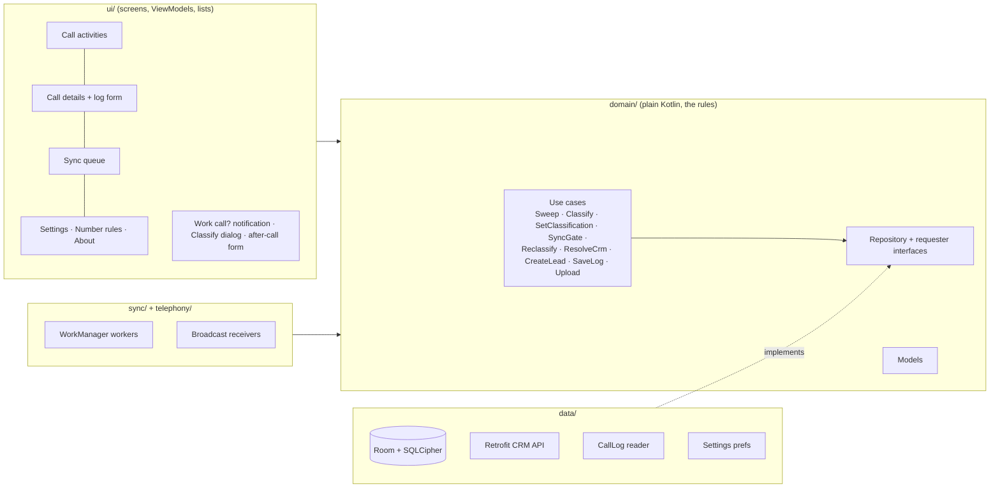
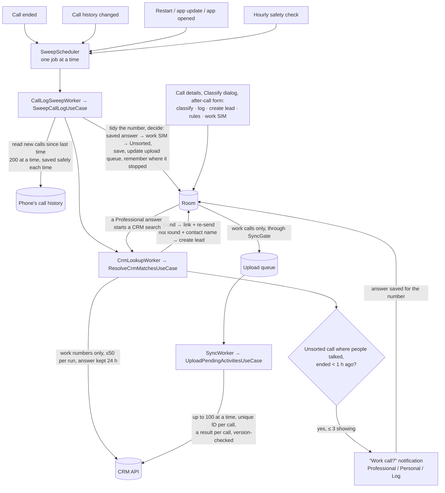
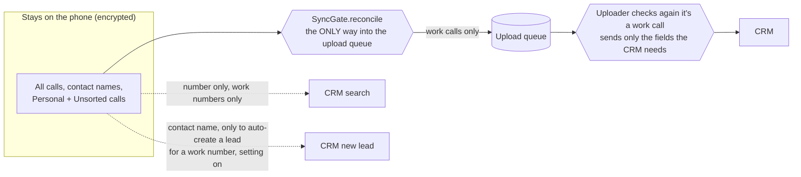

# Architecture

This page explains, in plain words, how Call Tracker is built.
(The app shows "Professional"; inside the code and the CRM the same thing is called BUSINESS.)

**In short:** one Android module, built with **MVVM + Clean Architecture**, **Hilt** for wiring parts together, and
**Coroutines/Flow** for background work. The local database (Room, encrypted with SQLCipher) is the **one source of
truth**: screens only show what is in the database, and anything that comes from the internet is saved there first.

## How the code is split

| Folder | What it holds | Rule |
|---|---|---|
| `domain/` | The data models, the **interfaces** for storage, and the use cases — every business rule lives here | No Android code at all, so every rule can be tested quickly on a computer |
| `data/` | The database, the encryption key, the call history reader, the CRM API, and the code that implements the domain interfaces | Does the work, but never decides the rules |
| `sync/` | Background jobs (WorkManager) and the code that schedules them | Each job is small: it calls one use case and reports done / try again |
| `telephony/` | Listeners for "call ended" and "phone restarted" | They only wake the app up; they read no call data |
| `ui/` | Screens (XML + ViewBinding), ViewModels, notifications, the after-call screen | Shows only what's in the database, never raw internet results |
| `di/` | Hilt setup (database, network, threads, interface bindings) | |

## From a phone call to the CRM

The product owner's call flow: **decide on the phone first, ask once per number, search the CRM only for work calls.**

1. **Finding calls.** Every trigger only *asks* for a read; the read itself uses the phone's **call history (CallLog)**,
   because it has the real type, length and SIM (the "call ended" signal doesn't). The app remembers where it stopped
   (plus a fixed 7-day limit), so each read picks up only new calls, reading twice is harmless, and a crash loses nothing.
2. **Deciding, using only what's on the phone** (`ClassifyCallUseCase`): the saved answer for the number, else the work
   SIM (Professional), else Unsorted. The CRM and the phone's contacts don't decide.
3. **Asking once.** Only for numbers with no saved answer, only for calls where people talked, only within an hour,
   never more than three notifications at once. Every answer (notification, Classify dialog, call screen) is saved for
   the number, and answering clears that number's other open notifications.
4. **The CRM, for work calls only** (`ResolveCrmMatchesUseCase`): only work numbers are searched, and a Professional
   answer starts a search straight away. Found → the call is linked (and re-sent if already uploaded). Not found → a
   lead is created from the contact name ("Create leads automatically", on by default), or a Create lead button is
   shown. Leads and Contacts are both searched first, and if the server says the lead already exists, that one is linked.
5. **Upload queue.** A work call gets an activity (with its own unique ID) and a place in the queue. Any later edit
   puts it back in the queue with a new version number.
6. **Upload.** Calls are sent in batches; the server answers for each call separately, and an answer is used only if
   the call hasn't changed since it was sent. If a CRM lead was deleted or merged, the link is fixed and the number is
   searched again at once.

## The privacy wall

- **One door into the upload queue:** `SyncGate.reconcile()`. Every change to a call's type or notes goes through it
  in the same database step, so the call and the queue can never disagree. A call that stops being a work call is
  taken out of the queue (unless it was already uploaded).
- **A second check:** just before sending, the uploader checks again that the call is a work call, and what it sends
  holds only the fields the CRM needs — no contact names.
- **CRM searches** send only the number, and only for work numbers. A number marked Personal (by a saved answer or by
  hand on any of its calls) is never searched.
- **A contact name** leaves the phone only as the name of an auto-created lead, for a work number, with the setting on.
- **Logs** contain only counts, HTTP codes and error types (checked by `LogHygieneTest`); release builds remove most logs.

## Background jobs

All background work uses **WorkManager**, always as a single named job (never two copies at once), with no
always-running service.

| Job | Started by | How it runs | What it does |
|---|---|---|---|
| `CallLogSweepWorker` | Call ended (+3 s), restart, app update, app opened, call history changed, every hour | A new request joins or replaces the waiting one; the hourly job is kept | Reads new calls; starts the CRM search |
| `CallLogChangedWorker` | Any change to the call history (set up again after every read) | Replaces the waiting one | Asks for a read — catches calls even if the "call ended" signal was blocked |
| `CrmLookupWorker` | After a read that found calls (runs even offline, so notifications aren't late); a Professional answer, rule or work-SIM change; a fixed CRM link (retry job, needs internet) | Joins or replaces; retries wait longer each time | Searches work numbers, links calls, creates leads; shows "Work call?" notifications (≤ 3) and offers the log form |
| `SyncWorker` | Anything added to the queue (5 s wait), app start, every hour, **Upload now** | Needs internet; retries after 30 s, then doubling | Uploads the queue |

## Storage

The database `calltracker.db` (version 3) is **encrypted with SQLCipher**. Its key is random, made once, and locked by
the phone's secure key store (Android Keystore), so it can't be copied out. If that key is ever lost, a new database is
made and the calls are read again from the call history. The database is never backed up or moved to a new phone.

| Table | What it holds |
|---|---|
| `calls` | One row per call from the call history: tidied number, type, times, SIM, work/personal and how it was decided, linked CRM lead or contact |
| `activities` | The CRM record for a work call: its unique ID, notes and other log fields, last edit time, server ID |
| `outbox` | The upload queue: one row per activity, with status, version number, tries and last error |
| `number_rules` | The **saved answer** for each number (Professional or Personal) |
| `crm_cache` | The CRM's last answer for each number (including "not in CRM") and when it was asked |
| `sweep_state` | Where the last call history read stopped, and the 7-day limit |

Settings (work SIM, create leads automatically, dismissed tips) are kept in plain `SharedPreferences`: nothing private
is there, and they can be read before the database opens. Old database versions are in `app/schemas/`; upgrades are in
`data/local/Migrations.kt` (going from version 2 to 3 turns earlier CRM/contact decisions into saved answers, so
nothing changes for the user on upgrade).

## Screens

One activity (`MainActivity`) switches between screens with plain fragment changes — too few screens to need a
navigation library. A side menu opens:
- **Call activities** — the call list, loaded page by page; All / Professional / Personal / Unsorted tabs; a "waiting
  to upload" banner opens the Sync queue.
- **Call details** — classify, CRM record, log form, create lead, upload status.
- **Sync queue** — Pending / Failed / Synced tabs, offline banner, Upload now.
- **Number rules** — the saved answers.
- **Settings** — work SIM, notifications, after-call screen, create leads automatically, battery tips, privacy.
- **Why this approach?**

Pop-ups that return an answer (Classify call, Create new lead, Call saved) are `DialogFragment`s using the Fragment
Result API, so they survive rotating the screen. The after-call form (`PostCallActivity`) appears over other apps after
a work call, or from the notification's Professional button, and offers Create lead for unknown numbers.

Look and feel: blue top bar; all colours are tokens in `values/colors.xml` and `values-night/colors.xml` (so dark mode
works everywhere); shared avatars and labels come from `ui/common/CallVisuals`.
