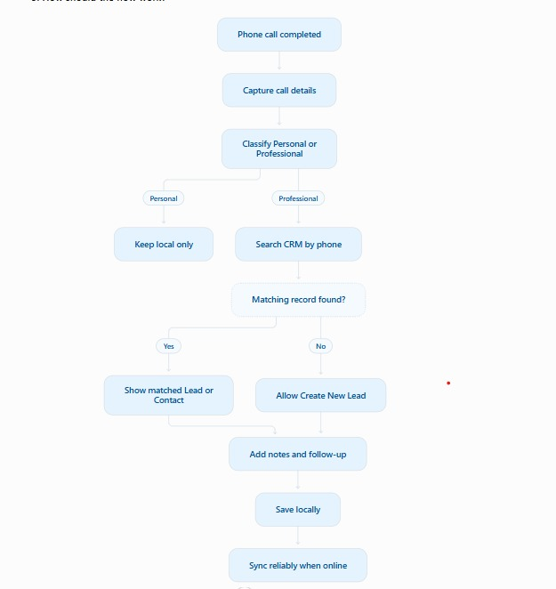
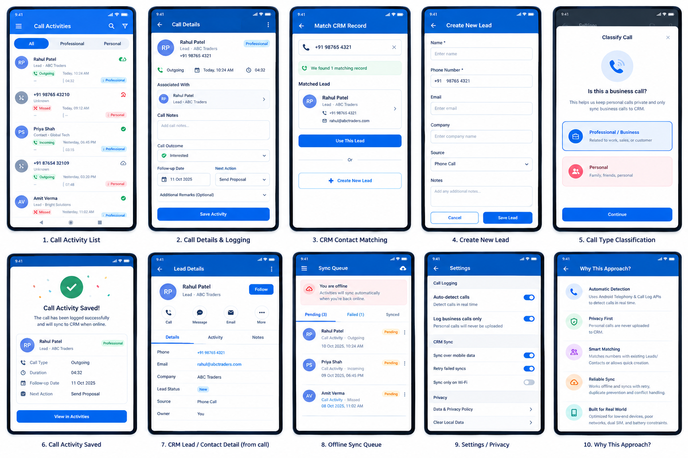

# Expected flow vs. the app

The expected flow (from the assignment discussion), checked against the app on 2026-10-10. It was tested on a Samsung A50
(Android 11) against the mock CRM.

## Step by step

| Flowchart step | In the app | Checked on the phone? |
|---|---|---|
| Phone call completed | When a call ends, `CallStateReceiver` (PHONE_STATE idle) and the CallLog content trigger start a sweep | Yes (seeded calls; no real call yet) |
| Capture call details | CallLog sweep → number, type, start/end, duration, SIM, stored in Room | Yes |
| Classify Personal or Professional | The number's saved answer → work SIM → otherwise Unsorted (asks once with a "Work call?" notification; the answer is saved) | Yes (asked once, then remembered; 0 lookups for unsorted/personal numbers) |
| Personal → keep local only | Only BUSINESS calls can enter the upload queue (`SyncGate.reconcile`); personal numbers are never looked up | Yes, the CRM received 0 personal calls |
| Search CRM by phone | Professional calls only: `CrmLookupWorker` → `GET /contacts/lookup` with the E.164 number | Yes (looked up right after Professional) |
| Match found → show Lead/Contact | The list shows the CRM name; details show "CRM contact · company"; the upload carries `leadId`/`contactId` | Yes |
| No match → allow Create New Lead | Auto-created from the phonebook name (setting, on by default); else "Create lead" on the call screen and in the after-call form; retry-safe via an idempotency key | Yes (auto-created from a phonebook name) |
| Add notes and follow-up | Notes, outcome, follow-up date, next action, remarks | Yes |
| Save locally | Room, encrypted with SQLCipher | Yes |
| Sync reliably when online | Outbox, exponential backoff, waits for a network, per-item results, generation guard | Yes (503s, offline, killed mid-upload: no duplicates) |

## Difference: when the CRM is searched (superseded: see "Call flow" below)

*History.* Until 2026-10-10 the app searched first; the product owner's call flow then settled it the other way.

- **Flowchart:** classify first, and search the CRM **only for Professional** calls. A personal call never touches the CRM.
- **Assignment §2:** "When a call is completed: **search for the phone number in CRM**", for every completed call. §3
  adds "minimize unnecessary user interaction", which searching first delivers: a known customer is never asked about.
- **App (follows the assignment):** the CRM lookup is **part of** classifying, so it also runs for numbers saved in the
  phone's contacts. Only the E.164 number is sent, as a lookup: no name, notes or call details, and nothing about the
  call is stored in the CRM. Nothing is uploaded unless the call ends up Professional. Numbers marked Personal by rule
  or by hand are never looked up (`CallDao.numbersNeedingCrmLookup`).
- **To match the flowchart instead:** don't look up numbers that are saved contacts (keep them Personal locally). The
  cost: customers saved in the phonebook must be marked Professional by hand or with a rule. Not done unless asked.

## Call flow from the product owner (2026-10-10): implemented

| Step / rule | The flow | The app now |
|---|---|---|
| 1 Call completed | — | The sweep imports it from the CallLog |
| 2–3 Saved classification? | Yes → skip the question; No → ask | The number's saved answer (rule) decides; else the work SIM (→ Professional, kept by choice); else one "Work call?" prompt |
| Remember | Never ask again once a number is classified | Every answer is saved for the number (notification, Classify dialog, call screen: "Remember for this number", ticked) |
| 4 Personal | Don't sync; end | Never uploaded, and the number is never sent to the CRM, not even as a lookup |
| 5 Professional → search CRM | Leads and Contacts | Only now: `numbersNeedingCrmLookup` lists BUSINESS numbers only; a Professional answer requests the lookup at once |
| 6 Found | Associate | Linked; uploaded (or re-sent) with `leadId`/`contactId` |
| 6 Not found | Auto-create if possible, else offer Create Lead | Auto-created from the phonebook name ("Create leads automatically", Settings, on by default); else Create lead (call screen, after-call form) |
| No duplicates | Check Leads and Contacts first | The lookup covers both; the server's 409 PHONE_EXISTS links the existing record |
| 7–8 Log call | Log and save against the record | After-call form / "Add notes" / call screen; the activity carries the link |

Deliberate departures: the **work SIM** still decides on its own (the product owner's choice), and **saved phone contacts
are asked once** (they used to be auto-Personal). Old data is kept by `MIGRATION_2_3` (DB v3): calls the CRM or a saved
contact had decided become saved answers. Trade-off vs. assignment §2 in [DECISIONS.md §1](DECISIONS.md).

## Assignment §2 and §3 review (2026-10-10)

| Requirement | Before | Change |
|---|---|---|
| §2 Search the CRM when a call completes | ✅ | — |
| §2 Found → associate Lead/Contact | ✅, but a stale link re-linked only at the next sweep (F2) | **Fixed:** the heal requests a lookup at once |
| §2 Not found → create a lead from the call | Only on the call's screen | **Also in the after-call form** ("Not in the CRM yet · Create lead") |
| §3 Intuitive mechanism | ✅ | The notification's Professional button now opens the log form |
| §3 Personal never synced | ✅ | Create lead is no longer offered on a Personal call (it would upload it) |
| §3 Professional available for logging | Answering Professional on the notification was a dead end | **Opens the log form**; in the Classify dialog, the call's screen scrolls to it |
| §3 Minimize interaction | Up to 3 prompts *per run* (22 piled up, F1); missed calls prompted too | **Never more than 3 showing**; no prompt for missed/rejected calls |
| §3 Explain the reasoning | Said "Business", missed the new ways to classify | **DECISIONS.md §1 rewritten** |

## Issues found in the same test run

- **F1, prompt cap — fixed.** `MAX_PROMPTS` was applied per `CrmLookupWorker` run, so 22 "Work call?" notifications
  piled up. Now at most 3 show at once, across runs; the newest calls keep theirs. Checked on the A50: 6 new unknown
  calls over 3 sweeps → 2, 3, 3 prompts showing.
- **F2, stale-link re-link delay — fixed.** After a deleted lead/contact was healed, nothing re-asked the CRM until the
  next sweep. The heal now requests a lookup (`CrmLookupRequester`). Checked on the A50: the lookup ran 0.3 s after
  the heal, and all 11 activities of the number were re-sent with the new lead id 30 s later, the note kept.
- **F3, conflict UX (open):** when the CRM copy is newer, the local edit is replaced without telling the user (this
  matches the last-write-wins contract).
- **Not run yet:** a real call, the work-SIM setting with real SIMs, reboot, wrong API token, release APK, DB plaintext
  check, rotation.

---

# Design mockup vs. the app

The look and feel was redesigned on 2026-10-10 after the 10-screen mockup below. It was checked screen by screen on the
Samsung A50, in light and dark mode. The agreed scope: restyle the existing screens, add the simple new ones, and use
only fields the CRM API supports. "Professional" is used in the UI for what the code calls BUSINESS.

| # | Mockup screen | In the app | Differences, and why |
|---|---|---|---|
| 1 | Call Activity List | Call activities (`CallListFragment`, `item_call`) | Adds a 4th **Unsorted** tab (calls not decided yet must stay findable). No search icon (no search feature). No filter icon or ⋮ menu: upload status and Upload now live on the Sync queue screen, which the "waiting to upload" banner opens. |
| 2 | Call Details & Logging | Call details (`CallDetailFragment`) | Adds the Professional / Personal choice and "Always for this number" (the app's classification). Remarks is a plain field. |
| 3 | Match CRM Record | "Associated with" card on Call details | Matching is automatic (by number, in the background), so there is no manual "Use this lead" step. Without a match, the card offers **Create new lead**. |
| 4 | Create New Lead | Full-screen form (`CreateLeadDialogFragment`) | Only Name and Company are editable. Phone comes from the call and Source is "Phone call". Email and Notes aren't in the CRM's `POST /leads`. |
| 5 | Call Type Classification | Classify call dialog (`ClassifyCallDialogFragment`), opened from the "Work call?" notification | Adds "Always for this number". |
| 6 | Call Activity Saved | `CallSavedDialogFragment` after Save | Adds "Back to call". |
| 7 | CRM Lead / Contact Detail | Not built | Needs email, status, owner and Follow / Message / Email actions the CRM API doesn't have. |
| 8 | Offline Sync Queue | Sync queue (`SyncQueueFragment`) | Same: offline banner, Pending (n) / Failed (n) / Synced tabs, upload-now icon. |
| 9 | Settings / Privacy | Settings, grouped (`fragment_settings`) | Shows the app's real settings (work SIM, after-call questions and screen, battery, privacy, rules). The mockup's toggles (Wi-Fi only, mobile data, auto-detect) don't exist in the app. |
| 10 | Why This Approach? | `AboutFragment` | Same five points, worded to match what the app actually does. |

Also new: a side menu (Call activities, Sync queue, Number rules, Settings, Why this approach?) and dark mode for every
screen.
